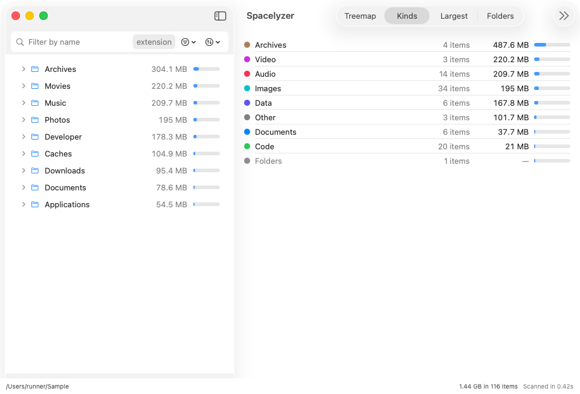
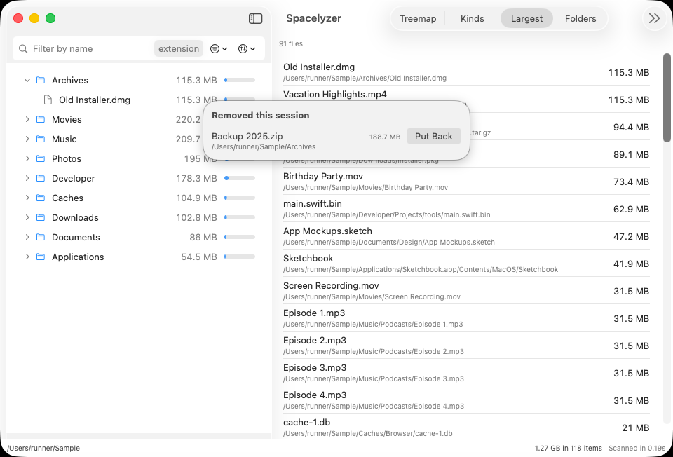

# Spacelyzer Native

See what is using your disk. A native macOS disk-space analyzer with a SwiftUI interface and a Rust engine.

## Explore before you remove

- Follow folders in the outline or compare their size in the treemap.
- Switch to Kinds for a file-type breakdown, or Largest for the 200 largest matching files.
- Combine name, extension, kind, size and modified-date filters across outline, treemap, Kinds and Largest. The Folders list is unfiltered.

- Check a scanned item on disk before deciding: preview, full path, size, then Move to Trash with Undo.
- Move several reviewed items at once, and put any of them back from the removal history.
- Review duplicate groups and move extra copies to the Trash.
- Export the Largest list as a CSV file.
- Skip chosen locations with exclusions; the Not scanned list shows what was skipped and why.

Removal History lists this session's removals. Each entry has its own Put Back, and a batch removal has one undo.

Sizes describe allocated disk space, with hard links counted once. Scans stay on your Mac; the app has no networking code.

## Install

Requires macOS 14 or later. Spacelyzer 0.9.x is early software: the app is self-signed and not notarized, so macOS asks you to approve it the first time. Download the DMG from [Releases](https://github.com/k-electron-bots/spacelyzer-native/releases).

1. Download the DMG and open it.
2. Drag Spacelyzer onto Applications.
3. Open it once, then approve it in **System Settings > Privacy & Security > Open Anyway**.

[Install and permissions](docs/guide/install.md) walks through each step with pictures, then [take the visual tour](docs/guide/tour.md).

The screenshots use sample data. Names, counts and times are examples.

See [known limitations](docs/guide/known-limitations.md) for what to expect from an early release.

## Documentation

| You want to... | Start here |
|---|---|
| Learn the app | [Quick start](docs/guide/quick-start.md) · [Visual tour](docs/guide/tour.md) · [Space, filters and Trash](docs/guide/space-and-safety.md) |
| Fix a problem | [Troubleshooting](docs/guide/troubleshooting.md) · [FAQ](docs/guide/faq.md) · [Known limitations](docs/guide/known-limitations.md) |
| Build or change it | [Development](docs/development/README.md) · [Architecture](docs/development/architecture.md) · [Engine CLI](docs/development/cli.md) |

MIT. See [LICENSE](LICENSE).
