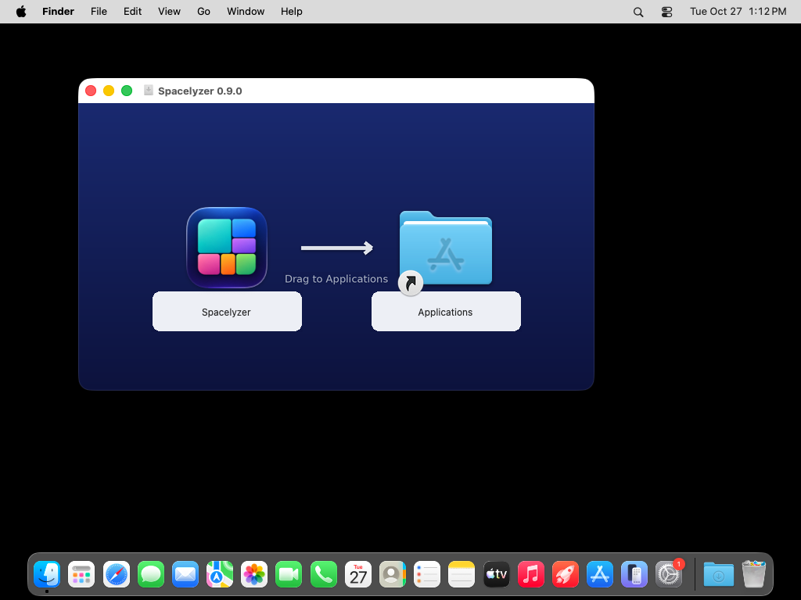
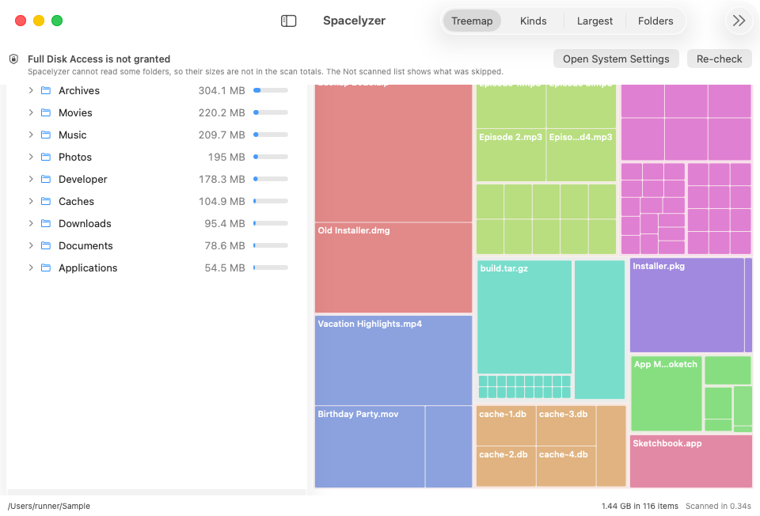

# Install and permissions

## Requirements
macOS 14 or later. Builds are in development; see [verification status](../verification/README.md) before relying on them for important cleanup.

## Install from the DMG
1. Download a development DMG from [GitHub releases](https://github.com/k-electron-bots/spacelyzer-native/releases).
2. Open the DMG. You get one window: the app on the left, your Applications folder on the right.
3. Drag Spacelyzer onto Applications.

<!-- CAPTURE: docs/images/install-dmg-window.png <- CI artifact screenshot-dmg-window.png, cropped to the Finder window -->

## First launch
The build is self-signed, not notarized, so macOS blocks the first open. On macOS 14 and later (steps verified against the macOS 14+ Gatekeeper flow):

1. Try to open the app once. macOS shows a warning and does not open it.
2. Go to **System Settings > Privacy & Security**.
3. Under Security, choose **Open Anyway** for Spacelyzer. macOS may ask for your login password.

Do not disable Gatekeeper or clear quarantine flags. Diagnostic builds are not a substitute for a release-readiness gate.

## Protected folders
Full Disk Access in **System Settings > Privacy & Security** may be needed to read protected locations; it does not guarantee complete coverage of every protected path. Without it, the app reports unreadable locations. A partial scan is not a complete view of your disk.

<!-- CAPTURE: docs/images/install-fda-banner.png <- CI artifact screenshot-fda-banner.png -->

No networking code is present in the app. Scanning and filtering run locally.

Continue with the [quick start](quick-start.md).
