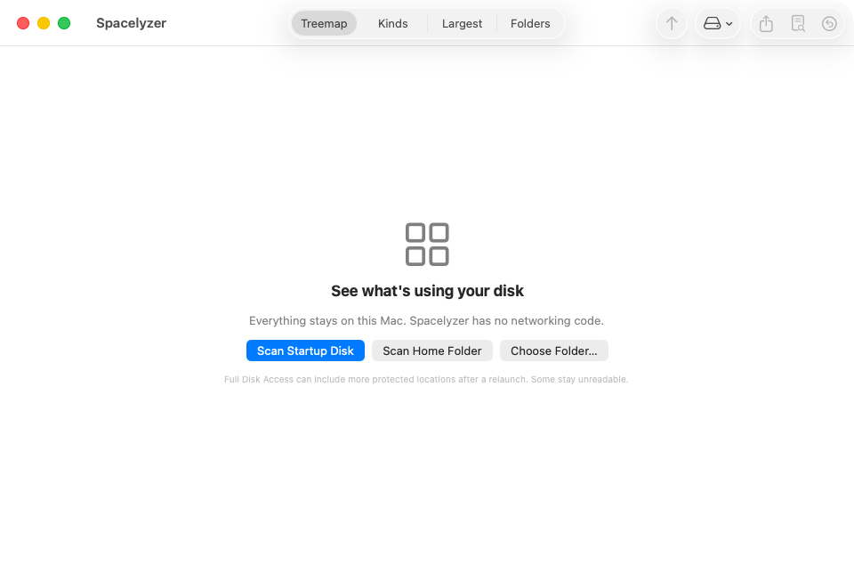
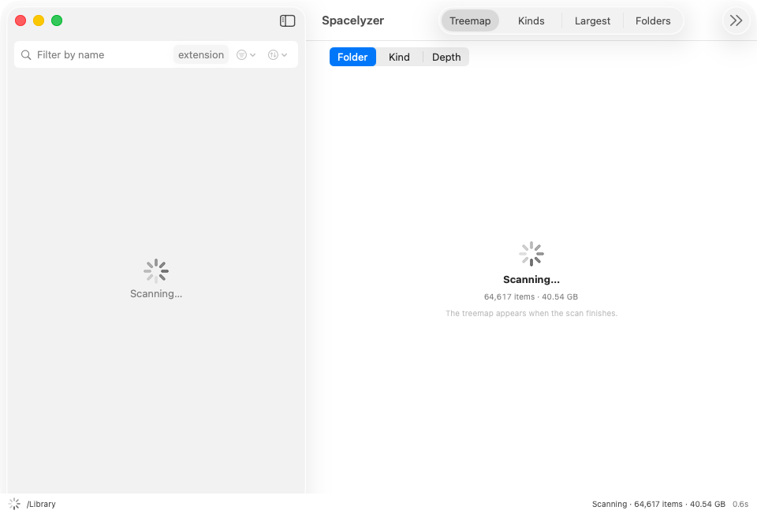
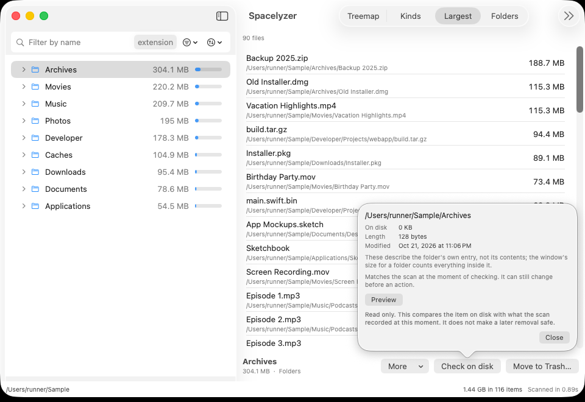

# Quick start

Four steps from download to a safe first cleanup. Screenshots use sample data; names, counts and times are examples, not what you will see on your Mac.

## 1. Open the app
After [installing](install.md), open Spacelyzer from Applications. The first window is the welcome screen.

## 2. Scan a location
Start a scan of your disk or a folder. The app reads everything it is allowed to read and shows progress as it goes. Locations macOS protects appear in the Not scanned list with their reason; [Full Disk Access](install.md#protected-folders) widens coverage but never guarantees every protected path.

## 3. Explore the result
Follow folders in the outline, compare areas in the treemap, or use Kinds and Largest for focused lists. Filters combine across every view.

## 4. Review, then remove
Select an item and check it on disk: preview, full path and size, refreshed from the filesystem. If it is what you expect, Move to Trash. The removal is confirmed with the full path, and Undo is available from the removal history. Batch removal moves several reviewed items in one pass with one undo.

Protected paths, selections outside the current filter and selections awaiting a filter result are refused. Read [space, filters and safe removal](space-and-safety.md) before deleting anything unfamiliar, and the [visual tour](tour.md) for a full walk of the views.
