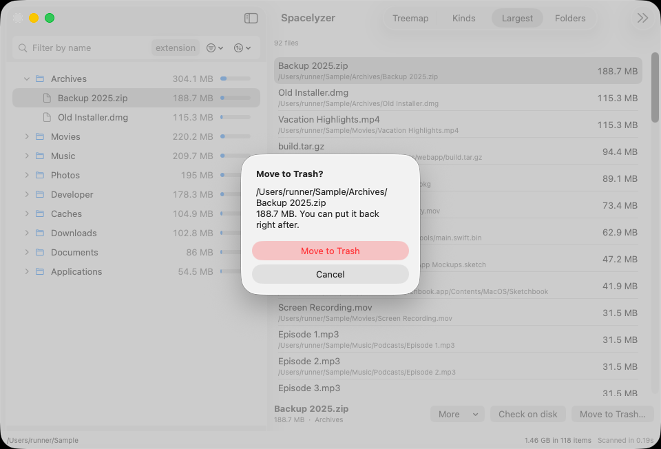
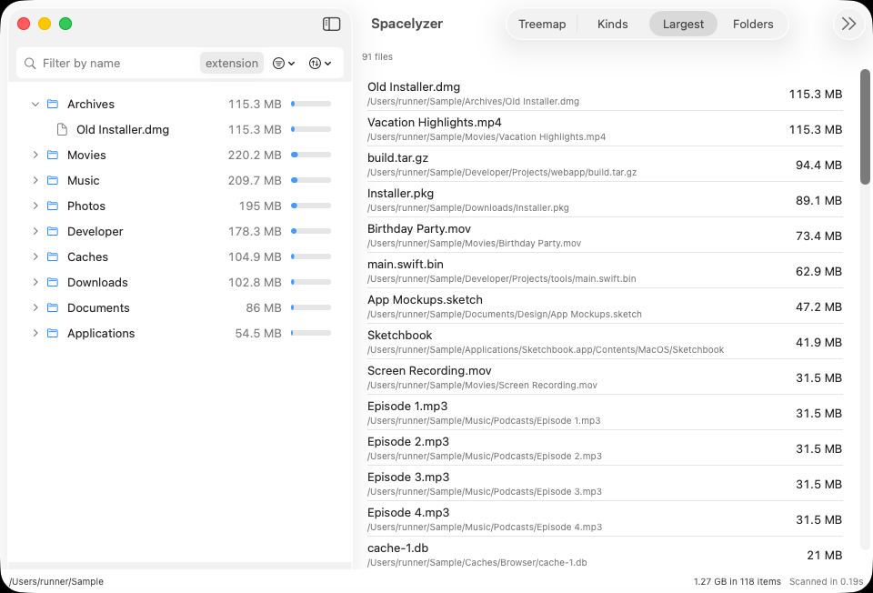

# Space, filters and safe removal

## What the numbers mean
Sizes are allocated bytes, rounded by filesystem blocks, rather than logical file lengths. Hard-linked files count once. Unreadable locations and canceled/partial scans limit coverage. Totals are not yet a full volume-accounting model: purgeable space, APFS snapshots and clone accounting remain open work.

## Combine filters
Name, extension, kind, minimum/maximum size and modified-date windows combine across outline, treemap, Kinds and Largest. Clear all filters resets them. The footer reports matching counts and bytes. A selected item can remain selected after it falls outside the filter, but cannot be removed in that state.

Zero-byte matching files are still matches. They remain in count-based lists even when there is no treemap area to draw.

## Review before removing
Check on disk shows an item as it is right now: preview, full path and size, refreshed from the filesystem rather than from the scan. The results can change between the scan and the review; the review says so when they do.

## Move to Trash

Captured on a shared CI Mac in run 40050466225 from source `9db328b5`, using the test-only build. This unmodified window-only image names the disposable fixture file `/Users/runner/Sample/Archives/Backup 2025.zip` (188.7 MB), not a personal file. [Screenshot provenance](../verification/screenshots-40050466225.json).

Review the full-path confirmation. Protected paths, selections outside the filter and selections awaiting a filter result are refused. Undo is available for removal. Do not treat this as permission to remove an unfamiliar system file.

Batch removal moves several reviewed items in one pass, with one undo for the batch. The removal history lists everything removed this session, newest first, each with its own Put Back. A restore returns the item to its original location; rescan to refresh the numbers afterward.

The same run visibly opened the compact-window history through the toolbar
overflow and showed this exact removed file. The Put Back button is visible;
this capture does not exercise it. Wide-window history capture failed because
the requested resize dimensions were not observed. This is narrower evidence
than a complete history acceptance result.

The [verification page](../verification/README.md) separates fixture-scoped
remove/undo and batch checks from real-hardware and failure limits. The whole
run still failed capture acceptance; these valid images do not turn it green.

## Export the Largest list
On the Largest tab, **Export CSV** saves the list as it was recorded at scan time to a file you choose. It reads nothing from the disk and changes no file other than that one. Columns are rank, size in bytes, path and a note. A path that cannot be written exactly (a name macOS stored in a form the scan could not represent) or that starts with a spreadsheet formula character is left blank with a note, never altered. The file is UTF-8 without a byte order mark; Excel may misread non-ASCII names when it opens the file directly, so import it with UTF-8 selected. The button is unavailable while the list is updating, out of date or empty, and nothing is written if the results change while the save panel is open. CSV formatting/export-flow/model-wiring checks passed on the Mac with injected save-panel/write seams. A real save panel, file readback and Excel/Numbers import remain unverified.
