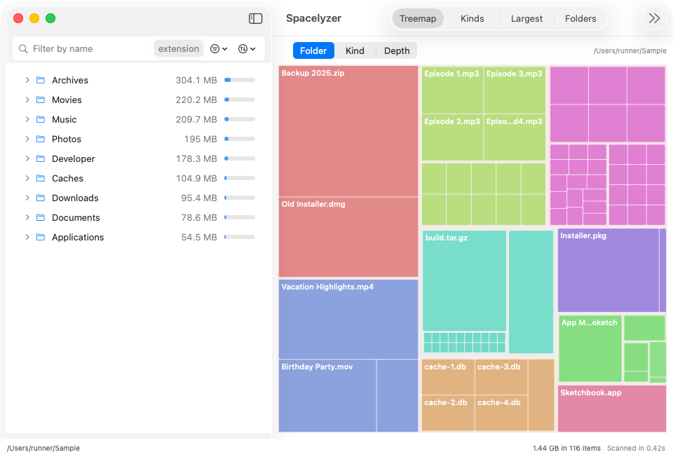
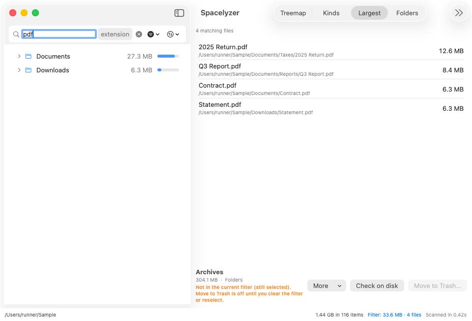
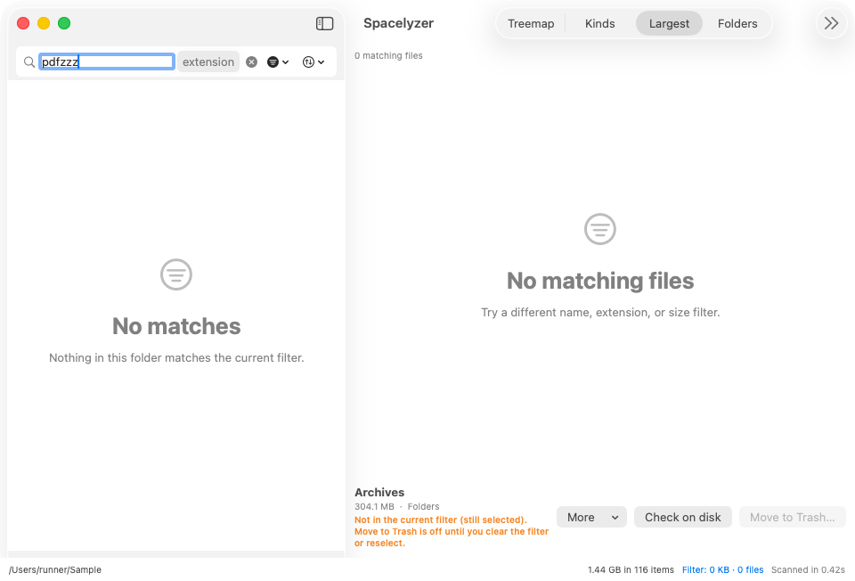

# Visual tour

These images were captured on a shared GitHub CI Mac (CI run 39683697776, October 2026; the review popover is from run 39690848529) and show the current interface. Their file names, counts and times are example scan results, not expected values for your Mac. Acceptance of behavior is tracked separately in [verification](../verification/README.md).

## Follow folders or compare areas

The outline shows folders and files with size bars. Expand a folder to follow its children. Selection reveals ancestors when needed. Arrow keys navigate; Right/Left expand and collapse; Return drills in. Cross-host Tab/Shift-Tab behavior is being repaired and is not yet accepted.

The treemap uses area for allocated size. Choose folder, kind or depth coloring. Hover for a readout, click to select, or double-click to drill in. Tiny regions combine into a labeled remainder. Zero-byte matches have no drawable area: use the outline or Largest to inspect them.

## See the file-type breakdown

Kinds groups matching files by type. This helps distinguish, for example, code from archives without leaving the selected scan.

## Find large files within a filter

Largest lists the 200 largest matching files and their paths. The header identifies the cap. A name filter of `pdf` changes every view. The orange selection warning means the selected item is outside the filter; Move to Trash stays unavailable until you clear the filter or select a matching item.

## Understand an empty view

No matches means the current filter excludes the files under the displayed root. It is distinct from matching files with zero drawable allocated space. Clear filters or inspect the outline/Largest rather than assuming the scan contains nothing.

Read [space, filters and safe removal](space-and-safety.md) before deleting files.
