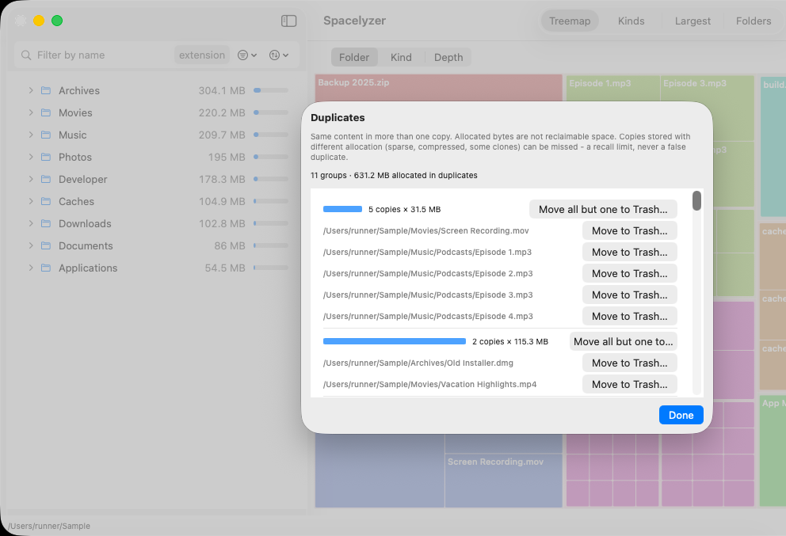
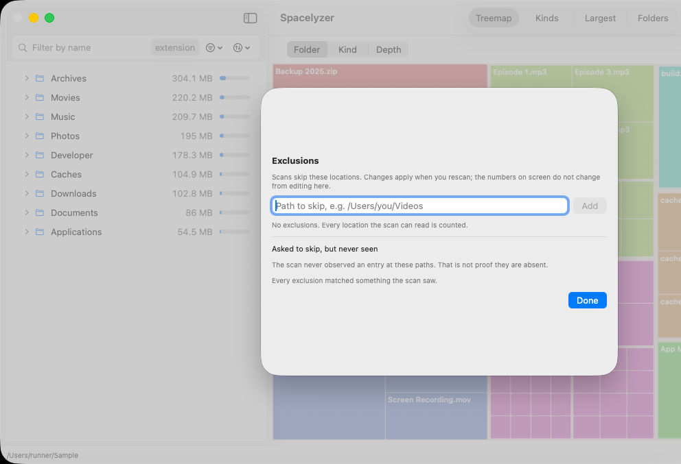

# Visual tour

These images were captured on a shared GitHub CI Mac (CI run 39683697776, October 2026; the review popover is from run 39690848529) and illustrate the interface at those checkpoints. The cleanup sections below use newer run 40050466225 images. Their file names, counts and times are example scan results, not expected values for your Mac. Acceptance of behavior is tracked separately in [verification](../verification/README.md).

## Follow folders or compare areas

The outline shows folders and files with size bars. Expand a folder to follow its children. Selection reveals ancestors when needed. Arrow keys navigate; Right/Left expand and collapse; Return drills in. Cross-host Tab/Shift-Tab checks have passed on the CI Mac; actual IME input remains unverified.

The treemap uses area for allocated size. Choose folder, kind or depth coloring. Hover for a readout, click to select, or double-click to drill in. Tiny regions combine into a labeled remainder. Zero-byte matches have no drawable area: use the outline or Largest to inspect them.

## See the file-type breakdown

Kinds groups matching files by type. This helps distinguish, for example, code from archives without leaving the selected scan.

## Find large files within a filter

Largest lists the 200 largest matching files and their paths. The header identifies the cap. A name filter of `pdf` changes every view. The orange selection warning means the selected item is outside the filter; Move to Trash stays unavailable until you clear the filter or select a matching item.

## Understand an empty view

No matches means the current filter excludes the files under the displayed root. It is distinct from matching files with zero drawable allocated space. Clear filters or inspect the outline/Largest rather than assuming the scan contains nothing.

Read [space, filters and safe removal](space-and-safety.md) before deleting files.

## Review duplicates without assuming every byte is recoverable

The review groups matching content and shows per-file or keep-one actions.
Allocated bytes are not necessarily reclaimable space. The screenshot's warning
explains limits for sparse, compressed and some clone copies. This capture shows
the review, not a duplicate removal. The dialog is fully visible, but the wider
background app is clipped at the right edge of the CI display.

## Choose exclusions for the next scan

Exclusions apply when you rescan. Editing this list does not change the numbers
already on screen. An excluded path the scan never saw is not proof that it is
absent. The dialog is fully visible; the background app is clipped at the right
edge of the CI display.

## Review the exact file, then find it in Removal History

Check the full path before confirming. This is a disposable sample file, not a
personal file. The app refuses protected, stale or filtered-out selections.

The same session's compact window opened this history through the toolbar
overflow after moving that file. Put Back is visible; no restore is claimed by
this image. The wide-window capture did not pass, so positioning at that width
remains unverified.

These five new cleanup images are unmodified window-only captures from
[run 40050466225](https://github.com/k-electron-bots/spacelyzer-native/actions/runs/40050466225),
source `9db328b5`, on a shared CI Mac with disposable sample data. See
[screenshot provenance](../verification/screenshots-40050466225.json) and
[the failed run's exact limits](../verification/2026-10-23-combined-verification.md).
The run's 166 ordering checks and 178 UI assertions passed, but its Not scanned
observer and wide-history capture failed. The new images do not establish a
clean run or release readiness.
